<h1 align="center">
  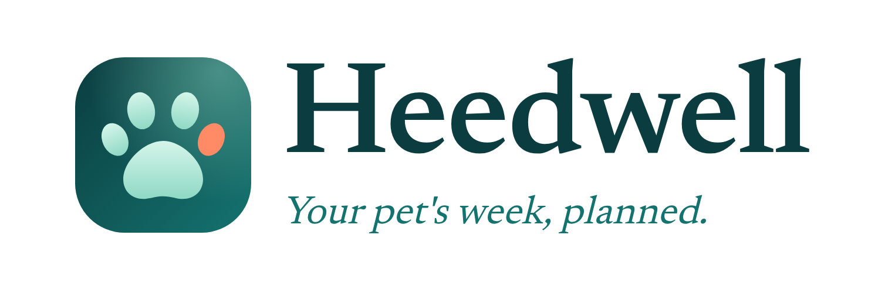
</h1>

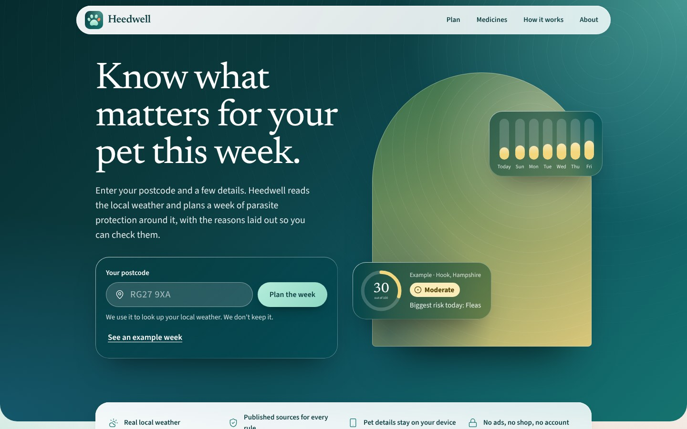

Heedwell is a small web app for UK dog and cat owners. You give it a postcode and a few details about your pet, and it uses the local weather to show how active ticks, fleas, harvest mites and lungworm are likely to be over the next seven days. Every score comes with the reasons behind it and the published source for each reason, and there is a one-page summary you can take to your vet.

Parasite risk changes with the weather. Ticks wake up after a run of mild days, fleas like damp air, harvest mites follow late summer. Most advice is a flat "treat every month", which is sensible but doesn't tell you why this week is different from the last. I wanted to see how far real weather data could go in making that concrete, without pretending to be a vet.

It is an independent concept. I built it while applying for the software engineering placement at Elanco UK, and Elanco hasn't made, reviewed or endorsed it. It isn't veterinary advice.

## What it does

### Home

The home page explains the idea, then lets you try it before you give anything away. The "example week" section runs the real scoring rules on a made-up week of weather, so you can tap through the days and watch the scores change. There are short sections on how it works, the four parasites, what the vet summary looks like, where your data goes, and common questions.

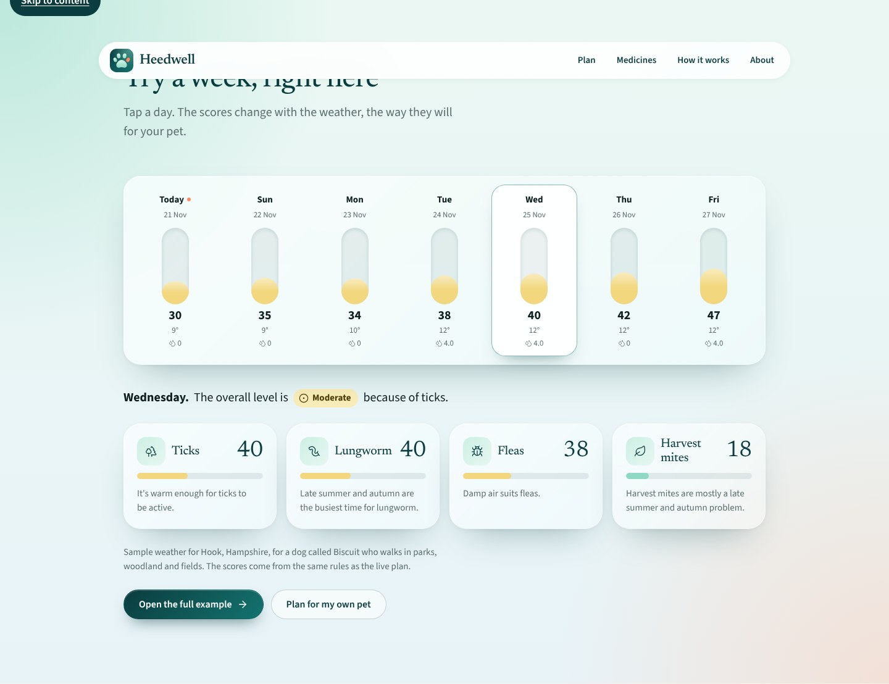

### Setting up your pet

Setup is seven short steps: postcode, species and name, age, where they walk, habits, who else is at home, and anything you've noticed. You can skip any step and get an average-pet plan instead.

Pet owners know things a fixed list can't cover, so each step has an "Other" option. Pick it and a box opens where you can write in your own words, for example an age like "about 5, a rescue" or a place like "a farm at weekends".

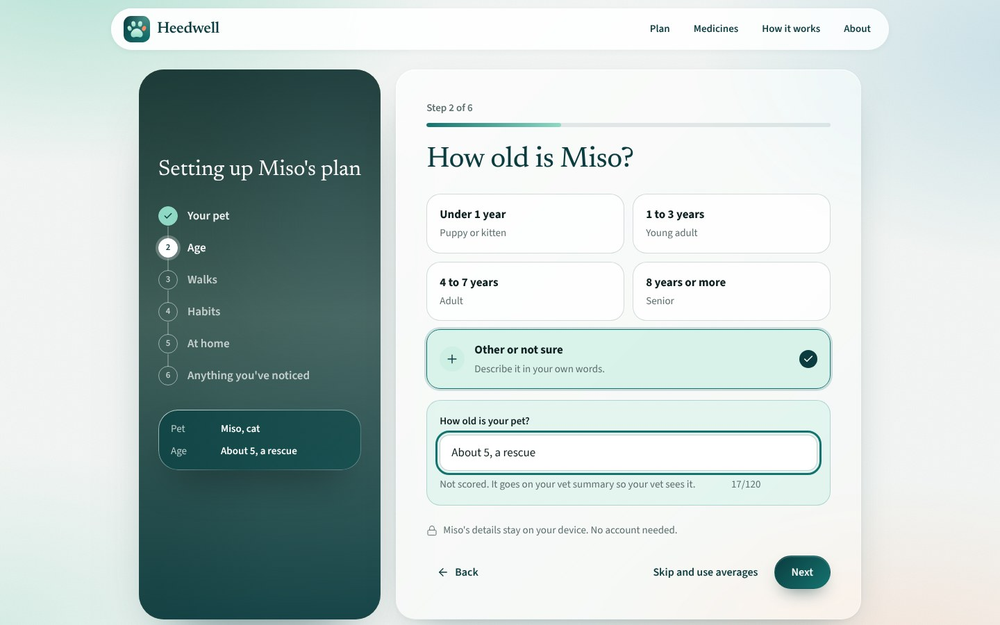

The last step is for symptoms and concerns. Heedwell can't tell you what a symptom means, and it says so. What you write isn't scored. It is shown on your plan and printed on the vet summary so your vet sees it. If you tick something that could be an emergency, such as trouble breathing, or write a word like "bleeding", the page tells you to call your vet now instead of waiting for a plan.

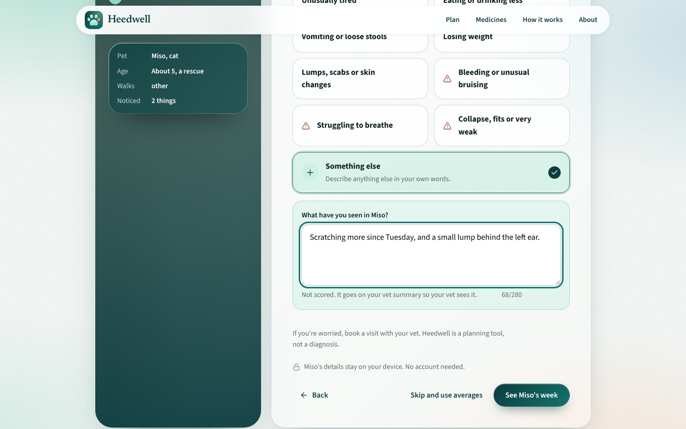

### The plan

The plan page opens with the week in a sentence, then five quick facts: the overall level, the highest and calmest days, the rain, and the temperature range. Below that is the week ribbon, seven days with a level for each. Tap a day and every score on the page updates. A level is never shown by colour alone: each one also has a word and an icon, and the higher levels have a pattern.

Under the ribbon is a card for each parasite with a score, a seven-day trend and a short list of what to do this week. At the bottom is the weather the plan was built from, the last seven days and the next seven, drawn from the Open-Meteo data.

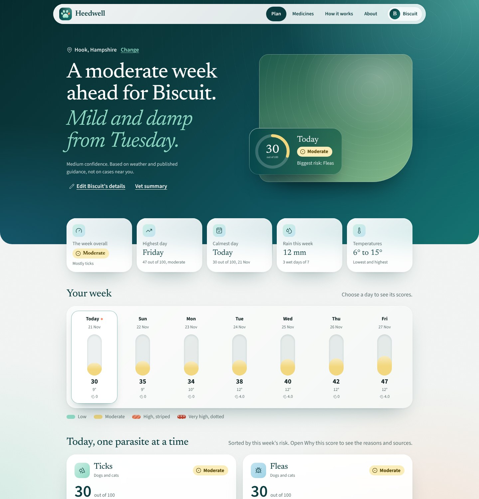

### Why this score

Each card has a "Why this score" button. It opens a panel listing every factor that pushed the score up or down, how strongly, the figures behind it (for example the humidity averaged over the last seven days), and the source for the rule. It also lists what Heedwell doesn't know.

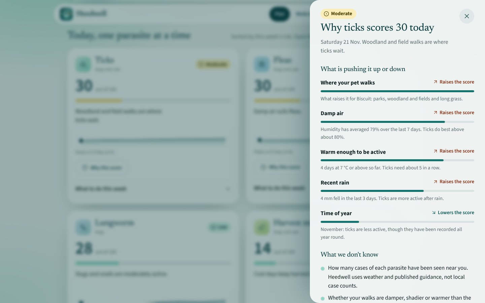

### The vet summary

One printable page with the pet's details, anything the owner wrote, the week at a glance, and a short list of questions to ask. You can print it, save it as a PDF, copy a link, or email it. The link carries the pet's details and the first half of the postcode only, and the app warns you before you copy it. A QR code on the page opens the online version.

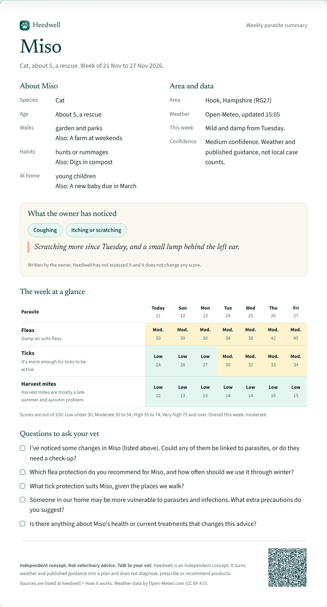

### Ingredient check

Pick the animals in your home, type the active ingredient from a box or leaflet, and Heedwell tells you which animals it is authorised for in the UK, using the Veterinary Medicines Directorate's public register. It works at the level of ingredients and never names a product, because prescription-only veterinary medicines can't be advertised to the public in the UK ([GOV.UK](https://www.gov.uk/guidance/advertising-veterinary-medicines)). There are no buy buttons and no doses.

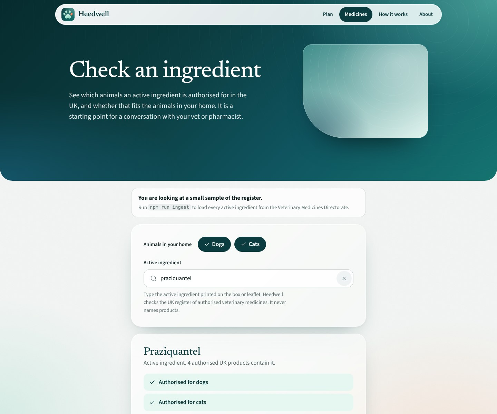

### How it works

A plain-English page that shows how a score is built, what is real data and what is modelled, what Heedwell won't do, and every source.

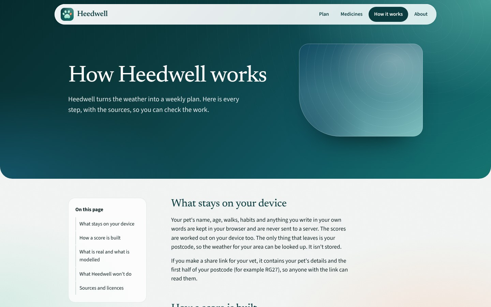

### On a phone

Everything works on a small screen too.

<p>
  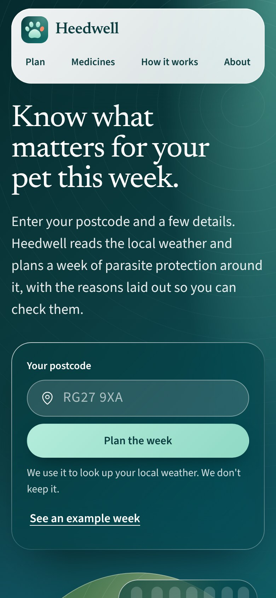
  &nbsp;&nbsp;
  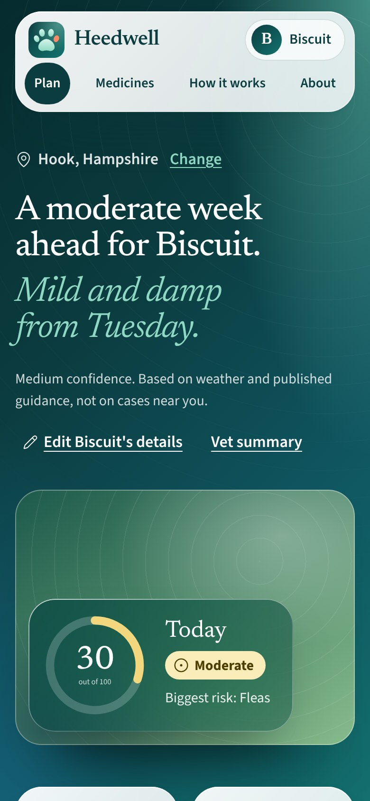
</p>

These screenshots are made by `npm run screenshots` against a stand-in weather service, so the numbers in them are made up. The photographs appear once you've run `npm run setup`, and show as soft gradients until then.

## Run it

You need Node 20.9 or newer.

```bash
npm install
npm run dev
```

Then open http://localhost:3000. The first `npm run dev` also downloads the photographs and the full UK medicines register, which takes a little while. You can do that step on its own with `npm run setup`. The app still works if it fails: you'd see a small sample of the register, with a banner saying so, and gradients where the photos go.

| Command | What it does |
| --- | --- |
| `npm run dev` | Start the app for development |
| `npm run build` then `npm start` | Production build, then serve it |
| `npm run check` | Lint, type-check and run the tests |
| `npm run setup` | Download the medicines register and the photographs |
| `npm run ingest` | Rebuild `data/medicines.json` from the VMD register |
| `npm run photos` | Download the photographs listed in `data/photos.json` |
| `npm run screenshots` | Retake the pictures in `docs/screenshots` (needs a build and Chrome) |

### Without a network

`scripts/mock-services.mjs` stands in for the postcode and weather services. Its numbers are synthetic and it exists for demos and screenshots. The app only uses it if you point it there:

```bash
node scripts/mock-services.mjs &
POSTCODES_API_BASE=http://127.0.0.1:4010 OPEN_METEO_API_BASE=http://127.0.0.1:4010 npm run dev
```

Try the postcodes RG27 9XA or SW1A 1AA.

## How the scoring works

1. `/api/forecast` looks up the postcode with [postcodes.io](https://postcodes.io) and fetches hourly weather for the past seven and next seven days from [Open-Meteo](https://open-meteo.com), then reduces it to one row per day.
2. The scoring rules in `src/lib/risk` run in the browser. They take the daily weather and the pet's profile and return a 0 to 100 score for each parasite on each day, with the factors and sources behind it. Nothing about the pet is sent to a server.
3. A score combines the weather over the previous seven days, the time of year, and the pet's routine. Weather and season alone can reach 80, and the routine decides the last 20.

These are simple, published rules and not a validated epidemiological model. Heedwell has no local case counts, so its confidence is never "high". [METHODOLOGY.md](METHODOLOGY.md) has every rule, number and source.

## Privacy

- The pet's name, age, walks, habits and anything written in an Other box are kept in your browser's local storage and never sent anywhere.
- Only the postcode leaves your device, to look up the weather. It isn't stored.
- A share link includes the pet's details and the first half of the postcode (for example RG27). Anyone with the link can read it.
- There are no accounts, no database, no analytics and no ads.

## Project layout

```
src/app/            pages and the two API routes
src/components/     interface pieces (week ribbon, parasite cards, why panel, setup, summary)
src/lib/risk/       the scoring rules, sources and engine
src/lib/weather/    postcode lookup and weather aggregation
src/lib/medicines/  ingredient search
src/styles/         design tokens, glass effects, page styles, print
data/               medicines register (generated) and photo credits
scripts/            data download, setup, screenshots, stand-in services
tests/              scoring, weather, profile and data tests
docs/screenshots/   the pictures above
```

## Built with

Next.js 16 (App Router), React 19 and TypeScript. The styling is plain CSS with no UI kit, the icons are from lucide, and the fonts are Newsreader and Source Sans 3. Tests run on Vitest, and GitHub Actions runs lint, type-check, tests and a build on every push to main and every pull request.

## Data and licences

Weather is from Open-Meteo under CC BY 4.0. Its free service is for non-commercial use, which suits a portfolio project, and a commercial product would need a paid plan. Medicines data is from the Veterinary Medicines Directorate under the Open Government Licence v3.0. Photographs are from Unsplash. Full credits are in [ATTRIBUTIONS.md](ATTRIBUTIONS.md).

## Where I'd take it next

- A version a vet practice could brand and put its own regional notes on.
- A local sightings signal alongside the weather, once there's a reliable open source for it.
- Calendar reminders for the days the plan marks as high.

## Licence

The code is MIT, see [LICENSE](LICENSE). The data and photographs keep their own licences.

> Independent concept. Not veterinary advice. Talk to your vet.
